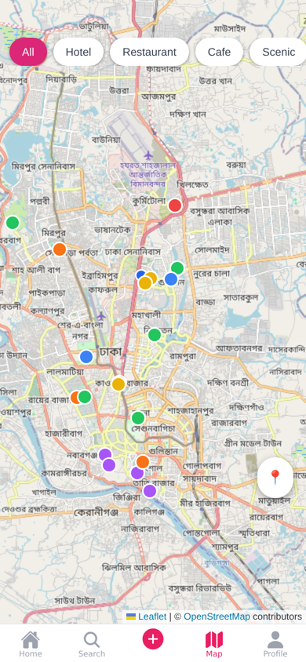
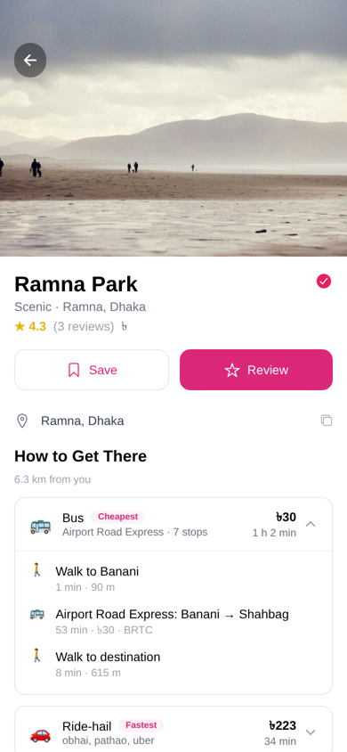
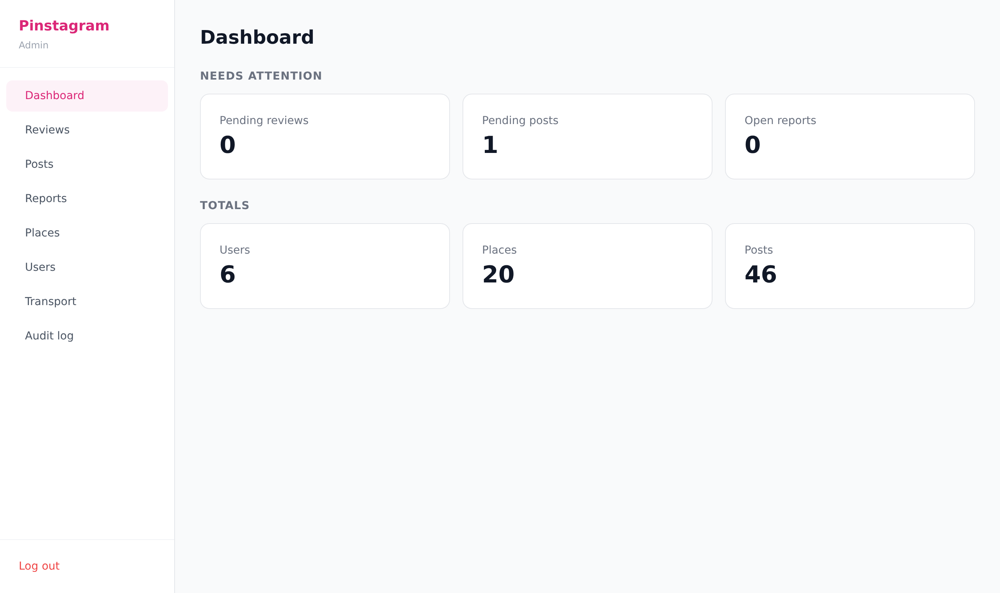
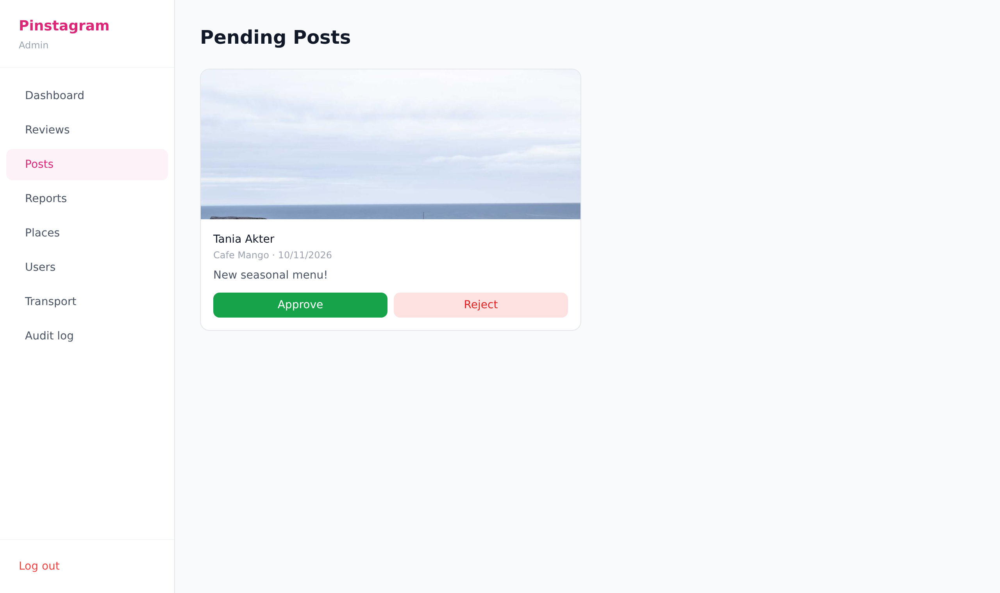
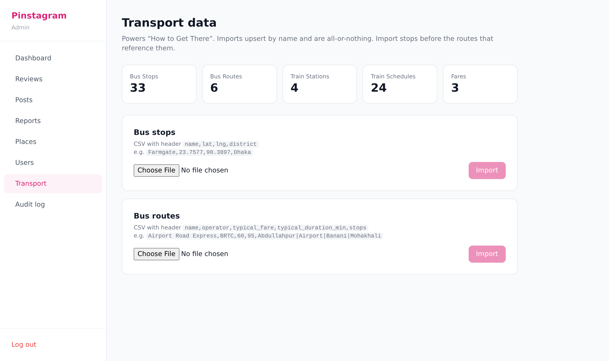
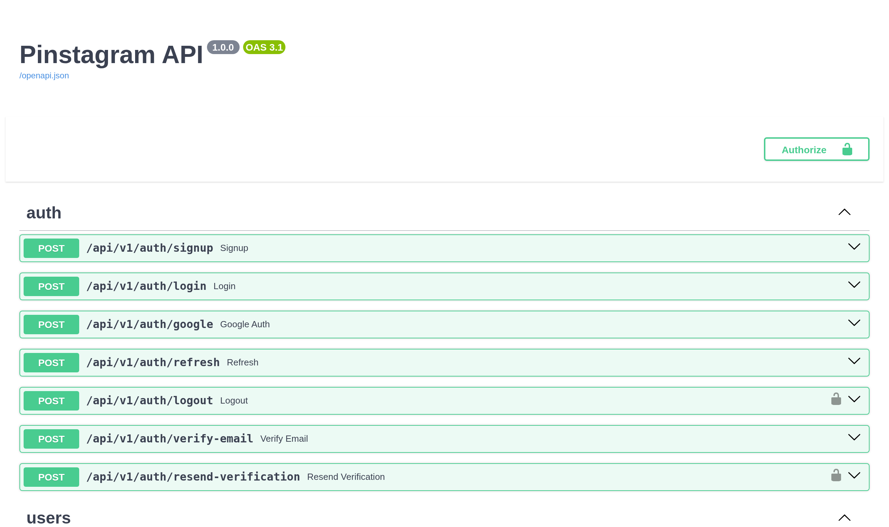
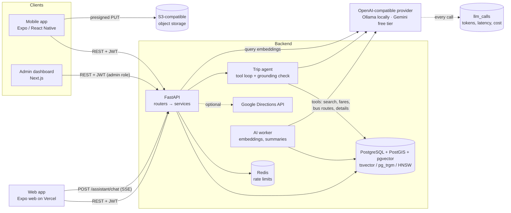

# Pinstagram

[](https://github.com/MadLad10/Pinstagram/actions/workflows/ci.yml)

**Live demo:** _add your Vercel URL here_. Click **Try the demo account** (the first load can take ~1 min while the free API instance wakes up).

A place-discovery app for Bangladesh: an Instagram-style feed of real places, a map, reviews, and **practical "how do I get there" directions**: which bus to take and what it costs, ride-hail estimates for Uber, Pathao and Obhai, train times, or whether it's walkable.

> "Show me a cafe in Banani, and tell me I can take the *Airport Road Express* from Mohakhali for ৳20 (about 30 min), or a Pathao for ~৳180."

On top of that sit three AI features that run on free models (Ollama locally, Gemini's free tier when hosted): **natural-language place search** ("quiet cafe where I can work on my laptop"), **review summaries** where every point cites its reviews, and a **trip-planning assistant** that answers only from the app's own places, routes and fares.

Three apps share one API:

| | Stack |
|---|---|
| **API** (`backend/`) | FastAPI · SQLAlchemy 2.0 async · PostgreSQL 15 + PostGIS · Redis · Alembic |
| **App** (`mobile/`): iOS, Android and web | React Native · Expo SDK 57 · Expo Router · TanStack Query · Zustand · NativeWind · Leaflet on web |
| **Admin dashboard** (`admin/`) | Next.js 14 · Tailwind |

## Highlights

### AI features

- **Hybrid search on pgvector.** Places and published reviews are embedded (bge-m3, 1024 dimensions, multilingual so Bangla works) into HNSW indexes. A query is matched semantically against both, and by keyword against the weighted `tsvector`, amenities and trigram name similarity. The two rankings are merged with Reciprocal Rank Fusion, then nudged by area, category and distance. Filters are hard constraints inside each query. Search finds a cafe for "laptop" because its *reviews* say so, shows the matching review as the reason, and falls back to keyword ranking if the embedder is down. ([`hybrid_search_service.py`](backend/app/services/hybrid_search_service.py))
- **Grounded review summaries.** Pros, cons and "best for", generated in the background from published reviews only. The model must cite the reviews behind every point, and grounding is enforced in code: a point is dropped if it cites nothing, cites a review it wasn't shown, quotes a number (price, time) its reviews don't contain, or shares no content words with them. The API returns each point's review ids. A worker regenerates summaries after new reviews arrive, or immediately if a cited review is unpublished. ([`summary_service.py`](backend/app/services/summary_service.py))
- **Trip-planning agent.** A tool-calling loop (search, place details, fares, bus routes, ride-hail) streamed over Server-Sent Events. It has a step limit, per-tool timeouts, invalid tool arguments returned to the model as errors it can recover from, and a request deadline. After answering, a grounding check flags any place the tools didn't return and any fare not in a tool result. Per-user rate limits and a daily token budget apply. ([`agent.py`](backend/app/ai/agent.py), [`tools.py`](backend/app/ai/tools.py))
- **One provider layer, every call logged.** A single httpx client for any OpenAI-compatible endpoint (Ollama, Gemini, OpenAI, Groq). Every call is written to `llm_calls` with tokens, latency, status and cost: $0 on free tiers, alongside what the same traffic would cost at list price. ([`app/ai/`](backend/app/ai/))
- **Measured, not eyeballed.** An eval script scores search ranking and the agent's tool use on hand-written cases ([Evaluation](#evaluation)).

### Core app

- **Transit routing on PostGIS.** For every bus route that serves a stop near the origin and a stop near the destination, each boarding/alighting pair is scored on door-to-door time (walk + wait + ride + walk). Fare and ride time are prorated by the stops ridden, and the cheapest and fastest options are labelled. Ride-hail prices use per-provider base/km/minute rates and estimated road distance, or live Google traffic when a key is set. Train options show the next departure in Dhaka time. ([`directions_service.py`](backend/app/services/directions_service.py))
- **Full-text and fuzzy search.** A generated, weighted `tsvector` column with a GIN index supports prefix matching ("cafe ban" finds *Banani Book Cafe*), and `pg_trgm` similarity tolerates typos ("lalbag" finds *Lalbagh Fort*). User input is tokenized, so it can never inject tsquery syntax.
- **Keyset pagination everywhere.** Opaque cursors over `(sort_key, id)` row comparisons, with no `OFFSET`. The ranked feed freezes its scoring timestamp inside the cursor so items don't shift or repeat between pages.
- **Moderation pipeline.** Posts and reviews enter a queue, and admins approve or reject them from the dashboard. Every admin action is written to an audit log in the same transaction. Resolving a report can unpublish the content (recomputing the place's rating) or ban the author and revoke their sessions.
- **Auth that holds up.** Argon2 password hashing and short-lived JWT access tokens. Refresh tokens rotate on every use, and **replaying a used refresh token revokes all of that user's sessions** (theft detection). Email verification attempts are capped per account, and login timing doesn't reveal which emails exist.
- **Rate limiting** in Redis per [API.md](API.md#rate-limits-v1): 10/min per IP on auth, 30 comments/min, 5 posts/day for free accounts, and global read/write limits. Responses carry `Retry-After`, and the limiter fails open if Redis is down.
- **Concurrency-safe counters.** Likes, saves and follows use `INSERT … ON CONFLICT DO NOTHING RETURNING` plus atomic `UPDATE … SET n = n + 1`, so double-taps and races can't skew counts.
- **Direct-to-storage uploads.** The API issues presigned S3 PUT URLs with server-generated keys, the phone uploads straight to storage with a progress bar, and the API verifies size and existence before creating the post.
- **Bulk transport data.** Admins import bus stops and routes from CSV. Imports are all-or-nothing, and errors are reported with line numbers.

## Screenshots

| Feed | Map | Directions | Profile |
|---|---|---|---|
|  |  |  |  |

| Admin: dashboard | Admin: moderation queue |
|---|---|
|  |  |
| **Admin: transport CSV import** | **API: OpenAPI docs** |
|  |  |

## Architecture



Routers are thin: they validate input with Pydantic and delegate to `app/services/*`, which own every query and transaction. Model access goes through one provider interface in `app/ai/`, which tests and the eval script swap for deterministic fakes. The AI worker runs inside the API process: it embeds new places and reviews and regenerates stale review summaries, so requests never wait on a model except for the query embedding and the assistant. More detail in [ARCHITECTURE.md](ARCHITECTURE.md), [DATA_MODEL.md](DATA_MODEL.md) and [API.md](API.md).

## Quick start

Requires Docker and Node 22+.

```bash
cp backend/.env.example backend/.env
docker compose up -d postgres redis s3          # Postgres+PostGIS, Redis, S3 storage
docker compose --profile full up -d --build backend   # API on :8000 (runs migrations)
docker compose exec backend python -m app.scripts.seed_dev
```

- API docs: http://localhost:8000/docs
- Admin: `cd admin && npm install && npm run dev` → http://localhost:3001 (`admin@pinstagram.app` / `admin1234`)
- Mobile: `cd mobile && npm install && npx expo start`, then scan the QR code with Expo Go (`demo@pinstagram.app` / `demo1234`). On a phone, point `EXPO_PUBLIC_API_BASE_URL` at your computer's LAN IP.

The seed loads 25 Dhaka places (real landmarks plus fictional cafes and restaurants), 33 bus stops on 6 routes along the main corridors, 4 rail stations with timetables, and demo users with posts, likes, comments and 108 place-specific reviews. A native Python setup is described in [SETUP.md](SETUP.md).

### Turning on the AI features

They're off by default (`AI_ENABLED=false`), and the app works fully without them. Everything below is free.

**Locally with Ollama:**

```bash
ollama pull qwen2.5:3b-instruct     # chat + tool calling (~2 GB)
ollama pull bge-m3                  # embeddings, 1024-dim, multilingual
```

Set `AI_ENABLED=true` in `backend/.env` (the other defaults point at Ollama on `localhost:11434`), restart the API, then embed the seeded data once:

```bash
docker compose exec backend python -m app.scripts.embed_backfill
```

After that the worker keeps embeddings and summaries up to date. On a CPU, the assistant takes tens of seconds per answer; `ASSISTANT_TIMEOUT_S` allows for that.

**Hosted, on Gemini's free tier:** use its OpenAI-compatible endpoint with an API key from Google AI Studio:

```bash
AI_ENABLED=true
LLM_BASE_URL=https://generativelanguage.googleapis.com/v1beta/openai
LLM_API_KEY=<your key>
LLM_MODEL=<a Flash-Lite model your key lists>
EMBEDDING_MODEL=gemini-embedding-001   # truncated to 1024 dims
```

[DEPLOY.md](DEPLOY.md#4-gemini-ai-features) shows how to list the models your key can use.

Switching embedding models means re-running `embed_backfill`, since vectors from different models can't be compared. Re-check `EMBEDDING_MIN_SIMILARITY` with the [eval script](#evaluation) too. On the web app, the AI features appear as the **Assistant** tab, natural-language search with filter chips in **Search**, and **What reviewers say** on place pages. The native app doesn't show them yet.

## Deployment

The web build of the app is hosted on Vercel; the API, Postgres/PostGIS, Redis and
images run on Render, Neon, Upstash and Cloudflare R2 free tiers. Step-by-step:
[DEPLOY.md](DEPLOY.md). The same codebase serves native and web: platform-specific
modules (`PlacesMap.web.tsx` with Leaflet, a web token store, browser dialogs) are
picked at build time by Metro.

## Testing

```bash
docker compose up -d postgres redis
cd backend && pytest --cov
```

162 tests (90% coverage), mostly integration tests, run against **real Postgres + PostGIS + pgvector and Redis**: geography queries, full-text and vector search, constraints and rate limits are all exercised for real. Only object storage and the models are stubbed. Models are replaced by deterministic fakes (a scripted LLM and a hashed bag-of-words embedder), so no test touches the network. The tests cover the moderation loop, pagination stability, refresh-token reuse detection, the routing algorithm, CSV import validation, hostile search input, hybrid ranking and its keyword fallback, summary grounding, and the agent's limits, timeouts and recovery from bad tool calls.

CI ([`.github/workflows/ci.yml`](.github/workflows/ci.yml)) installs pgvector into the PostGIS service, then runs ruff, a migration up/down/up round trip, the test suite and the offline eval. It also builds the admin dashboard, typechecks the app, and builds the web bundle.

## Evaluation

[`backend/evals/`](backend/evals/) scores the AI features on hand-written cases over the dev seed: 20 search queries, each with the places that should come back, and 10 assistant prompts, each with the tools it should call and key arguments. It runs in its own database (`bdvisual_eval`), seeded and embedded with the chosen embedder.

```bash
cd backend
python -m evals.run                    # offline: fake embedder + rule-based planner (CI runs this)
python -m evals.run --provider real    # the models configured in .env
```

- **Search:** hit@3, hit@5 and MRR over the top 10, for keyword-only and hybrid ranking side by side, plus p50/p95 latency and how often hybrid fell back to keyword search.
- **Agent:** tool-call precision and recall (harmless extra calls such as reading a place's details are allowed per case), argument accuracy (place ids are resolved to names), cases fully correct, answers passing the grounding check, failed tool calls, and p50/p95 latency. One case checks that the assistant asks where the trip starts instead of inventing an origin.

Results are written to `evals/results/` as JSON and a markdown report. Search with bge-m3 on Ollama (CPU):

| Mode | hit@3 | hit@5 | MRR | p50 |
|---|---|---|---|---|
| Keyword only | 0.90 | 0.95 | 0.86 | 7 ms |
| Hybrid | **1.00** | **1.00** | **0.97** | 349 ms |

Hybrid finds what keyword search misses when the words are only in reviews ("somewhere to go jogging", "greenhouses and a cactus house"), and it answers a Bangla query (পুরান ঢাকার বিরিয়ানি) that keyword search returns nothing for.

Agent on Ollama (CPU), with the 3B default and a smaller 1.5B model:

| Model | Tool precision | Tool recall | Argument accuracy | All correct | Grounded answers | Failed tool calls | p50 | p95 |
|---|---|---|---|---|---|---|---|---|
| `qwen2.5:3b-instruct` | 1.00 | 0.62 | **0.62** | **0.50** | 0.67 | 4 | 256 s | 600 s |
| `qwen2.5:1.5b-instruct` | 1.00 | 0.62 | 0.33 | 0.40 | 0.70 | 5 | 34 s | 99 s |

Neither model calls a tool it shouldn't, but both often skip steps. The 1.5B model plans a fare to "Old Dhaka" without first searching for a biryani place, drops the `near` area and sometimes invents a place id. The 3B model fills in arguments far more accurately and chains search → fare correctly, but it still stops after `search_places` when a question needs `get_place_details` (opening hours, reviews), and it answered one multi-step prompt without calling any tool. The guardrails catch much of this. Invalid calls (4 and 5) went back to the model as errors instead of failing the chat. The grounding check flagged the 3 answers from each model that quoted fares or places no tool returned.

The 3B run shared a CPU host with other workloads. One case hit the 600 s assistant timeout, which sets the p95. The machine also had no room for the embedding model at query time, so `search_places` fell back to keyword search for that run.

After these runs, the system prompt and the `search_places` description were changed. They now say that search results have no hours or reviews, and that every part of a question needs a tool. A re-run of the 4 cases the 3B model had missed used a fake embedder, so its search ranking differs from the full run. In that re-run, "Is Ahsan Manzil open on Thursdays?" went through `get_place_details` and became fully correct. The rooftop prompt now searches before answering, though with the wrong area. The other two still miss. The 10-case table above comes from before the change. These numbers are the case for a stronger hosted model (Gemini's free tier).

The offline run's rule-based planner was written alongside the agent cases, so its perfect agent score only shows the harness and cases agree. On a slow CPU, raise `ASSISTANT_TIMEOUT_S` and `--embed-timeout` so slow calls aren't scored as timeouts and fallbacks.

## Project layout

```
backend/
  app/api/v1/        routers (public + admin/)
  app/services/      business logic and queries
  app/ai/            model providers, agent + tools, indexing, worker, call logging
  app/models/        SQLAlchemy models
  alembic/versions/  migrations
  tests/             integration tests
  evals/             search and agent eval cases + runner
mobile/
  app/               Expo Router screens: (auth), (tabs), place/[id], profile/[id], notifications
  components/  lib/  store/
admin/src/app/       dashboard pages: posts, reviews, reports, places, users, transport, audit
```

## Status and roadmap

v1 scope from [PROJECT.md](PROJECT.md) is implemented end to end: auth, profiles and follows, the feed, place pages, directions, posting with moderation, reviews, saved places, search, the map, and in-app notifications.

Not done yet:
- App-store builds (the web version deploys per [DEPLOY.md](DEPLOY.md))
- Google sign-in on mobile (the backend endpoint exists)
- Dhaka Metro Rail (MRT Line 6) in the routing data
- Crash reporting and analytics
- Push notifications (deferred to v2 by design)
