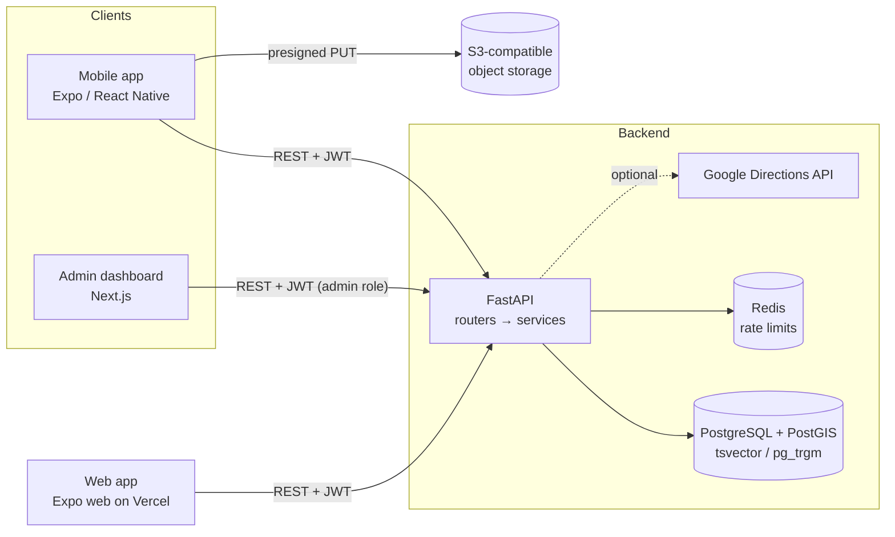

# Pinstagram

[](https://github.com/MadLad10/Pinstagram/actions/workflows/ci.yml)

**Live demo:** _add your Vercel URL here_. Click **Try the demo account** (the first load can take ~1 min while the free API instance wakes up).

A place-discovery app for Bangladesh: an Instagram-style feed of real places, a map, reviews, and **practical "how do I get there" directions**: which bus to take and what it costs, ride-hail estimates for Uber, Pathao and Obhai, train times, or whether it's walkable.

> "Show me a cafe in Banani, and tell me I can take the *Airport Road Express* from Mohakhali for ৳20 (about 30 min), or a Pathao for ~৳180."

Three apps share one API:

| | Stack |
|---|---|
| **API** (`backend/`) | FastAPI · SQLAlchemy 2.0 async · PostgreSQL 15 + PostGIS · Redis · Alembic |
| **App** (`mobile/`): iOS, Android and web | React Native · Expo SDK 57 · Expo Router · TanStack Query · Zustand · NativeWind · Leaflet on web |
| **Admin dashboard** (`admin/`) | Next.js 14 · Tailwind |

## Highlights

- **Transit routing on PostGIS.** For every bus route that serves a stop near the origin and a stop near the destination, each boarding/alighting pair is scored on door-to-door time (walk + wait + ride + walk). Fare and ride time are prorated by the stops ridden, and the cheapest and fastest options are labelled. Ride-hail prices use per-provider base/km/minute rates and estimated road distance, or live Google traffic when a key is set. Train options show the next departure in Dhaka time. ([`directions_service.py`](backend/app/services/directions_service.py))
- **Full-text and fuzzy search.** A generated, weighted `tsvector` column with a GIN index supports prefix matching ("cafe ban" finds *Banani Book Cafe*), and `pg_trgm` similarity tolerates typos ("lalbag" finds *Lalbagh Fort*). User input is tokenized, so it can never inject tsquery syntax.
- **Keyset pagination everywhere.** Opaque cursors over `(sort_key, id)` row comparisons, with no `OFFSET`. The ranked feed freezes its scoring timestamp inside the cursor so items don't shift or repeat between pages.
- **Moderation pipeline.** Posts and reviews enter a queue, and admins approve or reject them from the dashboard. Every admin action is written to an audit log in the same transaction. Resolving a report can unpublish the content (recomputing the place's rating) or ban the author and revoke their sessions.
- **Auth that holds up.** Argon2 password hashing and short-lived JWT access tokens. Refresh tokens rotate on every use, and **replaying a used refresh token revokes all of that user's sessions** (theft detection). Email verification attempts are capped per account, and login timing doesn't reveal which emails exist.
- **Rate limiting** in Redis per [API.md](API.md#rate-limits-v1): 10/min per IP on auth, 30 comments/min, 5 posts/day for free accounts, and global read/write limits. Responses carry `Retry-After`, and the limiter fails open if Redis is down.
- **Concurrency-safe counters.** Likes, saves and follows use `INSERT … ON CONFLICT DO NOTHING RETURNING` plus atomic `UPDATE … SET n = n + 1`, so double-taps and races can't skew counts.
- **Direct-to-storage uploads.** The API issues presigned S3 PUT URLs with server-generated keys, the phone uploads straight to storage with a progress bar, and the API verifies size and existence before creating the post.
- **Bulk transport data.** Admins import bus stops and routes from CSV. Imports are all-or-nothing, and errors are reported with line numbers.

## Screenshots

| Feed | Map | Directions | Profile |
|---|---|---|---|
|  |  |  |  |

| Admin: dashboard | Admin: moderation queue |
|---|---|
|  |  |
| **Admin: transport CSV import** | **API: OpenAPI docs** |
|  |  |

## Architecture



Routers are thin: they validate input with Pydantic and delegate to `app/services/*`, which own every query and transaction. More detail in [ARCHITECTURE.md](ARCHITECTURE.md), [DATA_MODEL.md](DATA_MODEL.md) and [API.md](API.md).

## Quick start

Requires Docker and Node 22+.

```bash
cp backend/.env.example backend/.env
docker compose up -d postgres redis s3          # Postgres+PostGIS, Redis, S3 storage
docker compose --profile full up -d --build backend   # API on :8000 (runs migrations)
docker compose exec backend python -m app.scripts.seed_dev
```

- API docs: http://localhost:8000/docs
- Admin: `cd admin && npm install && npm run dev` → http://localhost:3001 (`admin@pinstagram.app` / `admin1234`)
- Mobile: `cd mobile && npm install && npx expo start`, then scan the QR code with Expo Go (`demo@pinstagram.app` / `demo1234`). On a phone, point `EXPO_PUBLIC_API_BASE_URL` at your computer's LAN IP.

The seed loads 20 Dhaka places (real landmarks plus fictional cafes and restaurants), 33 bus stops on 6 routes along the main corridors, 4 rail stations with timetables, and demo users with posts, likes, comments and reviews. A native Python setup is described in [SETUP.md](SETUP.md).

## Deployment

The web build of the app is hosted on Vercel; the API, Postgres/PostGIS, Redis and
images run on Render, Neon, Upstash and Cloudflare R2 free tiers. Step-by-step:
[DEPLOY.md](DEPLOY.md). The same codebase serves native and web: platform-specific
modules (`PlacesMap.web.tsx` with Leaflet, a web token store, browser dialogs) are
picked at build time by Metro.

## Testing

```bash
docker compose up -d postgres redis
cd backend && pytest --cov
```

92 tests (89% coverage), mostly integration tests, run against **real Postgres + PostGIS and Redis**: geography queries, full-text search, constraints and rate limits are all exercised for real, and only object storage is stubbed. They cover the moderation loop, pagination stability, refresh-token reuse detection, the routing algorithm, CSV import validation, and hostile search input.

CI ([`.github/workflows/ci.yml`](.github/workflows/ci.yml)) runs ruff, a migration up/down/up round trip and the test suite against service containers, builds the admin dashboard, and typechecks the mobile app.

## Project layout

```
backend/
  app/api/v1/        routers (public + admin/)
  app/services/      business logic and queries
  app/models/        SQLAlchemy models
  alembic/versions/  migrations
  tests/             integration tests
mobile/
  app/               Expo Router screens: (auth), (tabs), place/[id], profile/[id], notifications
  components/  lib/  store/
admin/src/app/       dashboard pages: posts, reviews, reports, places, users, transport, audit
```

## Status and roadmap

v1 scope from [PROJECT.md](PROJECT.md) is implemented end to end: auth, profiles and follows, the feed, place pages, directions, posting with moderation, reviews, saved places, search, the map, and in-app notifications.

Not done yet:
- App-store builds (the web version deploys per [DEPLOY.md](DEPLOY.md))
- Google sign-in on mobile (the backend endpoint exists)
- Dhaka Metro Rail (MRT Line 6) in the routing data
- Crash reporting and analytics
- Push notifications (deferred to v2 by design)
